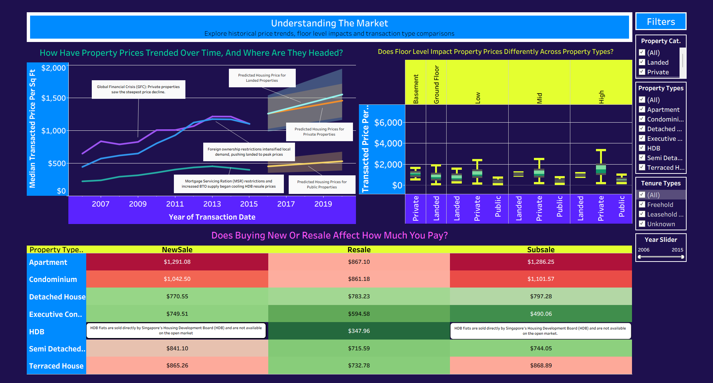
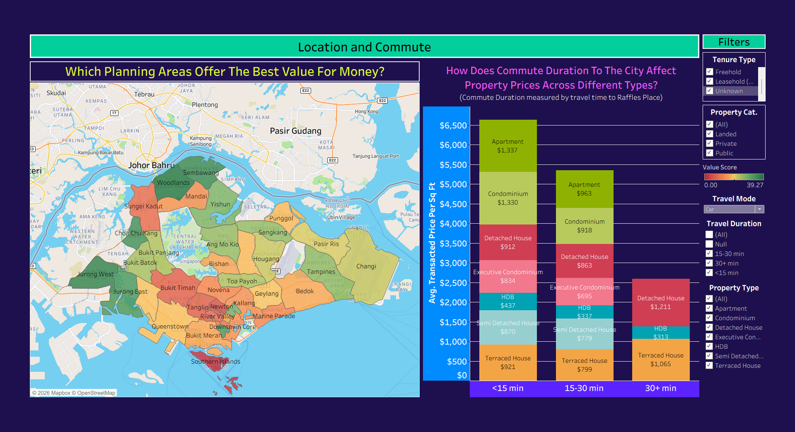
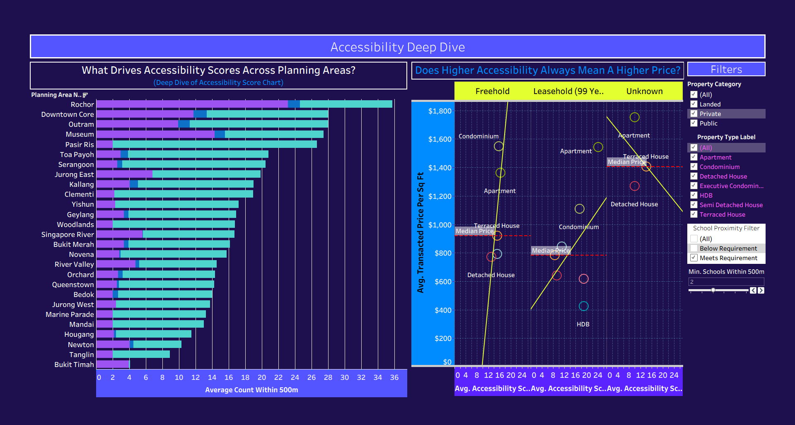

# Singapore Property Value Analysis

Helping middle-class family buyers find value-for-money residential properties in Singapore by weighing accessibility, location and budget across property types.

## Data
5 datasets (points of interest, private property amenities, spatial metrics, sales transactions, subzones), merged into **517,591 transactions**.

## Data cleaning (Python, pandas)
- Removed null rows and an irrelevant "Other" category in points of interest; fixed inconsistent labels (e.g. "busstop" → "Bus Stop")
- Filled missing amenity values with 0, since a blank meant the property lacked that amenity rather than missing data
- Filled missing property attributes (floors, units, completion year, bedrooms) with medians and removed duplicate records
- Converted 4 commute-time columns from seconds to minutes
- Merged datasets with left joins on `PropertyID` and `SubzoneId`

## Dashboards (Tableau)
7 charts across 3 dashboards, including a price trend with a 5-year forecast, a value-score map, and accessibility vs price analysis.

- **Accessibility Score** = bus stops + MRT stations + schools within 500m
- **Value Score** = Accessibility Score ÷ price per sq ft

## Key findings
- **Woodlands and Sengkang** had the highest value scores; Downtown Core and Orchard had the lowest
- Accessibility did not reliably predict price: HDB flats had the highest accessibility but the lowest price per sq ft
- From 2006 to 2015, public housing prices grew most steadily, while private property was the most volatile

## Tools
Python, pandas, Tableau
